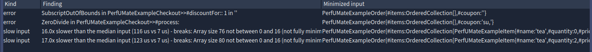
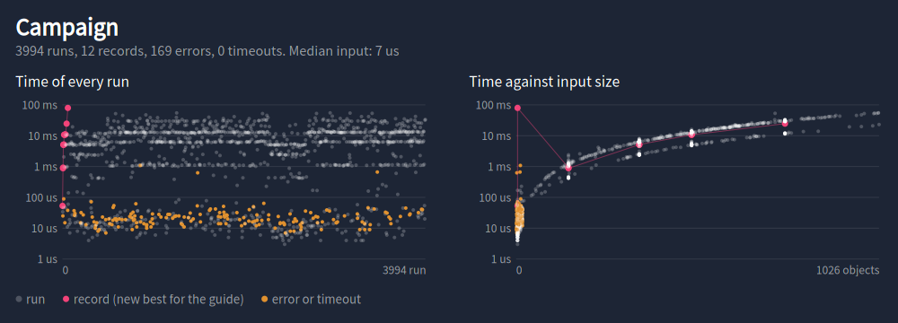
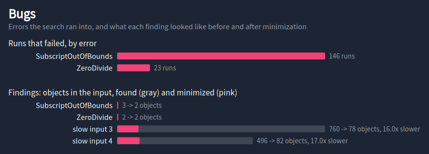
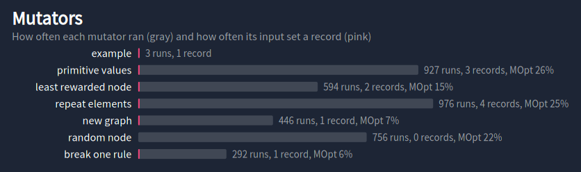
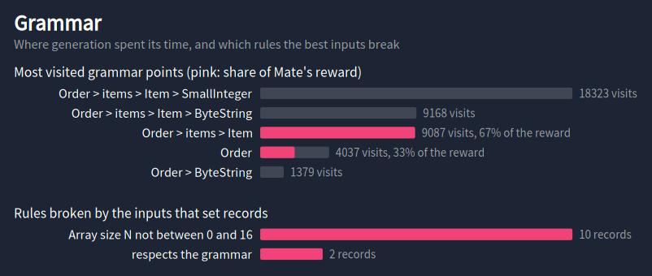
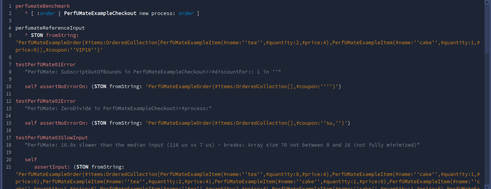
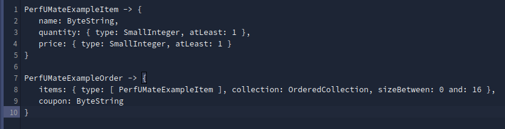

# PerfUMate

<p align="center">
  <a href="https://github.com/FedeLoch/PerfUMate/actions/workflows/ci.yml"></a>
  <a href="https://github.com/FedeLoch/PerfUMate/commits/main"></a>
  <a href="LICENSE"></a>
  <a href="https://pharo.org"></a>
</p>

Performance fuzzing for Pharo, from a few example objects.

Give PerfUMate a few example objects and a benchmark. It finds the inputs that make your code
slow, shrinks each one, and hands you an SUnit test that reproduces it. Use `lookFor: #errors`
to hunt crashes instead.

Built on [Mate](https://github.com/FedeLoch/Mate) (object graph grammars),
[Ume](https://github.com/FedeLoch/Ume) (guided fuzzing) and
[Shin](https://github.com/FedeLoch/Shin) (input minimization).

<p align="center">
  
</p>

## Install

```smalltalk
Metacello new
    baseline: 'PerfUMate';
    repository: 'github://FedeLoch/PerfUMate:main';
    onConflictUseIncoming;
    load.
```

## Example: slow inputs

This example ships with the tests (`PerfUMate-Tests`), so you can run it as is. A small checkout
processes orders: it sums the items, applies a coupon, computes the average unit price and the
loyalty points.

```smalltalk
PerfUMateExampleCheckout >> process: anOrder [
    | total units |
    
    total := anOrder items inject: 0 into: [ :sum :item | sum + (item quantity * item price) ].

    units := anOrder items inject: 0 into: [ :sum :item | sum + item quantity ].
    ^ { total - (self discountFor: anOrder). total // units. self loyaltyPointsFor: anOrder }
]

PerfUMateExampleCheckout >> loyaltyPointsFor: anOrder [
    "For every item, count the items with the same name"
    
    ^ anOrder items inject: 0 into: [ :points :item |
        points + (anOrder items count: [ :other | other name = item name ]) ]
]

PerfUMateExampleCheckout >> discountFor: anOrder [

    ^ (anOrder coupon first: 3) = 'VIP' ifTrue: [ 10 ] ifFalse: [ 0 ]
]
```

With the three example orders of the tests (one to three items, coupons `'VIP10'`, `'SPRING'`
and `'WELCOME5'`) nothing looks wrong. A one minute campaign:

```smalltalk
perfumate := PerfUMate new
    examples: PerfUMateExamples orders;                                  "required"
    benchmark: [ :order | PerfUMateExampleCheckout new process: order ]; "required"
    lookFor: #slowInputs;     "optional, the default"
    budget: 1 minute;         "optional, default 1 minute"
    slowdown: 10;             "optional, default 5"
    timeout: 1 second;        "optional, default 2 seconds"
    seed: 7;                  "optional, for reproducible runs"
    yourself.

perfumate grammar mateDefinition.   "optional: check what was inferred before running"
report := perfumate run.
report open.
```

The grammar inferred from the examples, with collection sizes widened to 16:

```
PerfUMateExampleItem -> {
    name: ByteString,
    quantity: { type: SmallInteger, atLeast: 1 },
    price: { type: SmallInteger, atLeast: 1 }
}

PerfUMateExampleOrder -> {
    items: { type: [ PerfUMateExampleItem ], collection: OrderedCollection, sizeBetween: 0 and: 16 },
    coupon: ByteString
}
```

The report:

```
PerfUMate: 2 slow input(s), 2 error(s) in 0:00:01:00
16.0x slower than the median input (116 us vs 7 us) - breaks: Array size 76 not between 0 and 16
17.0x slower than the median input (123 us vs 7 us) - breaks: Array size 80 not between 0 and 16
SubscriptOutOfBounds in PerfUMateExampleCheckout>>#discountFor:: 1 in ''
ZeroDivide in PerfUMateExampleCheckout>>#process:
```

The slow inputs are orders with 76 and 80 items, reduced from 758 and 494: `loyaltyPointsFor:` is
quadratic in the number of items. The broken rule says why the examples did not show it, as they
never had more than 3 items. The two crashes were found on the way: coupons shorter than 3
characters, and orders without units. [The report](#the-report) shows what else a report holds.

## Example: crashes and other bugs

To hunt for bugs instead of slow inputs, look for errors. The search is then guided by coverage
(each newly reached AST node counts) and by new error messages:

```smalltalk
report := PerfUMate new
    examples: PerfUMateExamples orders;                                  "required"
    benchmark: [ :order | PerfUMateExampleCheckout new process: order ]; "required"
    lookFor: #errors;
    instrument: { 'PerfUMate-Tests' };   "optional: code whose coverage guides the search"
    budget: 1 minute;                    "optional"
    run.
```

```
PerfUMate: 0 slow input(s), 2 error(s) in 0:00:00:48
SubscriptOutOfBounds in PerfUMateExampleCheckout>>#discountFor:: 1 in ''
    PerfUMateExampleOrder{#items:OrderedCollection[],#coupon:''}
ZeroDivide in PerfUMateExampleCheckout>>#process:
    PerfUMateExampleOrder{#items:OrderedCollection[],#coupon:'P10'}
```

Each error is minimized while keeping the same exception and the same method. The second input
keeps a 3 character coupon because a shorter one would hit the first bug instead. Errors are
located at the first method of your code on the stack, not at `Object>>errorSubscriptBounds:`.

## Performance Hunting Example Counting Method Calls

Execution time is noisy, and a loop that grows from 3 to 30 iterations barely shows in it.
Counting calls is exact. Give the methods to count and PerfUMate guides the search by how many
times they run (each method is its own objective, as in PerfFuzz):

```smalltalk
report := PerfUMate new
    examples: PerfUMateExamples orders;                                  "required"
    benchmark: [ :order | PerfUMateExampleCheckout new process: order ]; "required"
    measure: #methodCalls;                                               "or #bytecodes"
    instrument: {                                                        "required with #methodCalls"
        PerfUMateExampleCheckout >> #loyaltyPointsFor:.
        PerfUMateExampleItem >> #name
    };
    budget: 1 minute;                                                    "optional"
    run.
```

```
PerfUMate: 3 slow input(s), 1 error(s) in 0:00:01:00
9.1x slower than the median input (50 us vs 6 us) - breaks: Array size 41 not between 0 and 16
8.4x slower than the median input (46 us vs 6 us) - breaks: Array size 39 not between 0 and 16
7.6x slower than the median input (42 us vs 6 us) - breaks: Array size 37 not between 0 and 16
```

`instrument:` takes methods, classes or package names. Only what you give is instrumented, which
keeps each run cheap. Findings are still confirmed by execution time.

## The report

`run` answers a `PerfUMateReport`. `report open` shows it in an inspector, one tab per view:

<p align="center">
  
</p>

<p align="center">
  
</p>

**Campaign**: every run of the search, and its time against the size of its input. The curve on
the right is the complexity of the slow path, here quadratic.

<table>
  <tr>
    <td width="33%"><a href="images/report-bugs.png"></a></td>
    <td width="33%"><a href="images/report-mutators.png"></a></td>
    <td width="33%"><a href="images/report-grammar.png"></a></td>
  </tr>
  <tr>
    <td><b>Bugs</b>: errors hit during the search, and each finding before and after minimization.</td>
    <td><b>Mutators</b>: runs and records per mutator, and what MOpt ended up preferring.</td>
    <td><b>Grammar hits</b>: the most generated grammar points, and the rules the best inputs break.</td>
  </tr>
  <tr>
    <td colspan="2"><a href="images/report-tests.png"></a></td>
    <td><a href="images/report-grammar-definition.png"></a></td>
  </tr>
  <tr>
    <td colspan="2"><b>Tests</b>: the generated SUnit methods, one per finding.</td>
    <td><b>Grammar</b>: the grammar the campaign used, inferred from the examples and widened.</td>
  </tr>
</table>

Everything in the tabs is also available from code.

**Findings**

```smalltalk
report findings.                  "every finding; report slowInputs and report errors split them"
finding := report findings first.
finding summary.                  "one line, as in the report"
finding minimized.                "the reduced input, a real object"
finding original.                 "the input the search found"
finding minimizedSton.            "the reduced input as STON"
finding slowdown.                 "times slower than the median input (slow inputs)"
finding signature.                "error class and method of your code (errors)"
finding brokenRule.               "the grammar rule the input breaks, or nil"
finding isMinimized.              "false when minimization ran out of time"
```

**The trace**: every run of the search, kept to analyze the campaign afterwards.

```smalltalk
report trace runs.                "one PerfUMateRun per execution"
run := report trace runs last.
run microseconds.  run outcome.   "#ok, #error or #timeout"
run objects.       run mutator.   "input size, and the mutator that produced it"
run isRecord.      run input.     "records keep their input"
report trace records.             "the runs that set a record"
report trace mutatorStatistics.   "runs and records per mutator"
report trace mutatorProbabilities. "MOpt's final probabilities"
```

**Charts, grammar and campaign**

```smalltalk
report charts campaignCanvas open.   "also bugsCanvas, mutatorsCanvas, grammarCanvas (Roassal)"
report grammar mateDefinition.       "the grammar the campaign used"
report campaign.                     "Ume's own result (UmeResult)"
```

**Tests**

```smalltalk
report testSource.
report generateTestsIn: #CheckoutFuzzTest package: 'MyShop-Tests'.
```

The generated tests fail while the problems are there and pass once they are fixed. A slow input
test times the input against one of the examples in the same run, so it does not depend on the
machine (inputs shortened here):

```smalltalk
testPerfUMate01Error
    "PerfUMate: SubscriptOutOfBounds in PerfUMateExampleCheckout>>#discountFor:: 1 in ''"
    self assertNoErrorOn: (STON fromString: 'PerfUMateExampleOrder{#items:OrderedCollection[],#coupon:''''}')

testPerfUMate03SlowInput
    "PerfUMate: 16.0x slower than the median input (116 us vs 7 us)"
    self
        assertInput: (STON fromString: 'PerfUMateExampleOrder{#items:OrderedCollection[...76 items...]}')
        isAtMost: 10
        timesSlowerThan: self perfumateReferenceInput
```

**Saving and loading**

```smalltalk
report saveTo: 'perfumate-out'.
```

writes four files named after the campaign (`name:`, by default the examples' class):

| File | Content |
| --- | --- |
| `<name>.md` | the summary, with the minimized inputs |
| `<name>-tests.st` | the generated test methods |
| `<name>-trace.csv` | one row per run: run, microseconds, outcome, error, objects, mutator, record |
| `<name>.ston` | the whole report |

A saved report loads back with its findings, trace, grammar and tests, and opens with its charts,
for example a report saved by a nightly CI job:

```smalltalk
report := PerfUMateReport fromFolder: 'perfumate-out' name: 'checkout'.
report open.
```

## Options

Only `examples:` and `benchmark:` are required.

| Option | Default | What it does |
| --- | --- | --- |
| `examples:` | required | Example inputs. Mate infers a grammar from them (types, ranges, collection sizes), and the search starts from them. |
| `benchmark:` | required | A one argument block that runs the code under test on an input. |
| `receiver:selector:` | | Instead of `benchmark:`, runs `receiver perform: selector with: input`. |
| `lookFor:` | `#slowInputs` | `#slowInputs` searches for slow inputs. `#errors` searches for crashes, guided by coverage and new errors. A `UmeFeedbackGuide` gives your own measure. |
| `measure:` | `#executionTime` | For slow inputs: `#executionTime`, `#methodCalls` or `#bytecodes`. The last two count in the methods given to `instrument:`. |
| `instrument:` | from the benchmark | Methods, classes or package names. Required by `#methodCalls` and `#bytecodes`; for `#errors`, the code whose coverage guides the search. |
| `budget:` | `1 minute` | Total time. 80% goes to the search, the rest to confirming and minimizing the findings. |
| `slowdown:` | `5` | An input is slow when it is at least this many times slower than the median input (examples and generated inputs, each timed alone). |
| `timeout:` | `2 seconds` | Each run of the benchmark is stopped after this. An input that times out counts as slow. |
| `validity:` | `0.9` | Share of generated inputs that respect every rule of the grammar. The other 10% break exactly one rule, which is where code usually breaks. |
| `grammar` / `grammar:` | inferred | `grammar` answers the inferred grammar (`mateDefinition` prints it). Edit the text and pass it back with `grammar:` to fix a rule the examples got wrong, or to add one. |
| `widen:` | `true` | Inferred ranges and collection sizes are widened beyond the examples, since a few examples overfit. `false` keeps them as inferred. |
| `name:` | root class name | Names the campaign in summaries and saved reports. |
| `seed:` | random | Makes generation reproducible. |

Advanced options (`mutators:`, `mutatorSelector:`, `corpusHeuristic:`, `mutationsPerIteration:`,
`maxElements:`) are explained in [Technical architecture](https://github.com/FedeLoch/PerfUMate/wiki/PerfUMate-Technical-Architecture) and shown in
[Examples](https://github.com/FedeLoch/PerfUMate/wiki/Examples#9-choosing-mutators-selector-and-corpus-heuristic).

## In CI

A campaign can run as an SUnit test: subclass `PerfUMateCampaignTest` and call
`assertNoFindings:`. `PERFUMATE_BUDGET` (seconds) changes the budget without touching the code,
so pull requests can run short campaigns and nightly jobs long ones. See
[GitHub Actions integration](https://github.com/FedeLoch/PerfUMate/wiki/GitHub-Actions-Integration).

## More

- [Campaigns](campaigns/README.md): real campaigns on Pharo's own libraries (STON, Fuel, copying, equality, printing, hashed collections), the Termo hunt redone with PerfUMate.
- [Examples](https://github.com/FedeLoch/PerfUMate/wiki/Examples): step by step examples, from the minimal campaign to custom guides.
- [Technical architecture](https://github.com/FedeLoch/PerfUMate/wiki/PerfUMate-Technical-Architecture): how each part works and can be configured (corpus, grammar mutators, MOpt, feedback, weighted grammars, instrumentation, metrics).
- [Design](https://github.com/FedeLoch/PerfUMate/wiki/PerfUMate-design): design notes and proposed changes to Ume, Mate and Shin.
